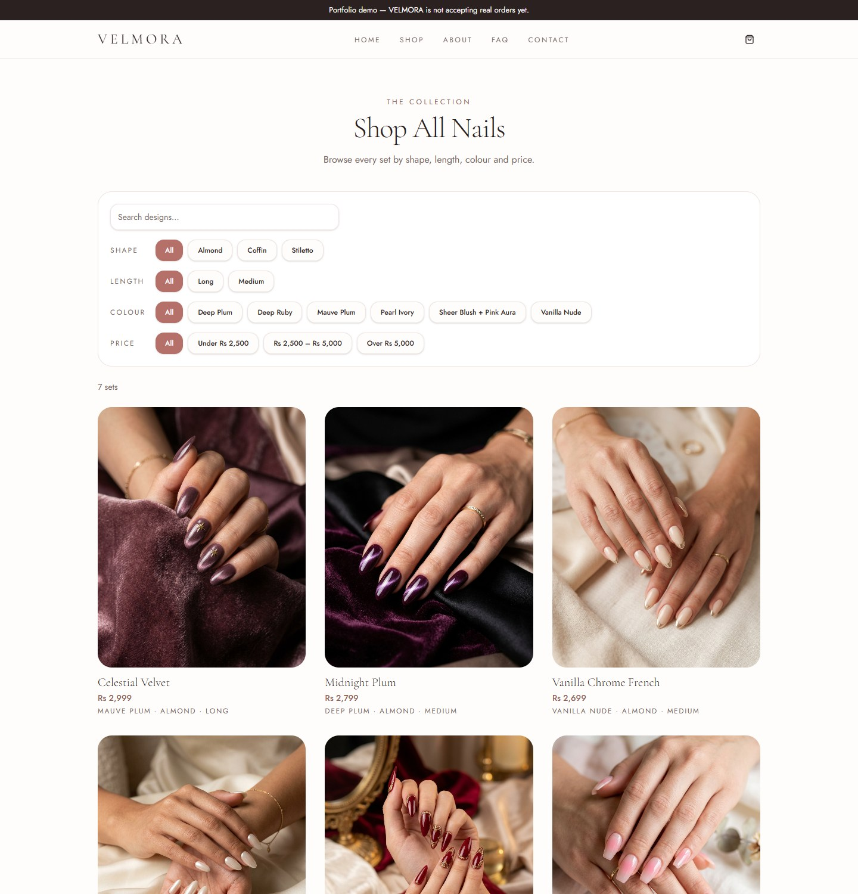
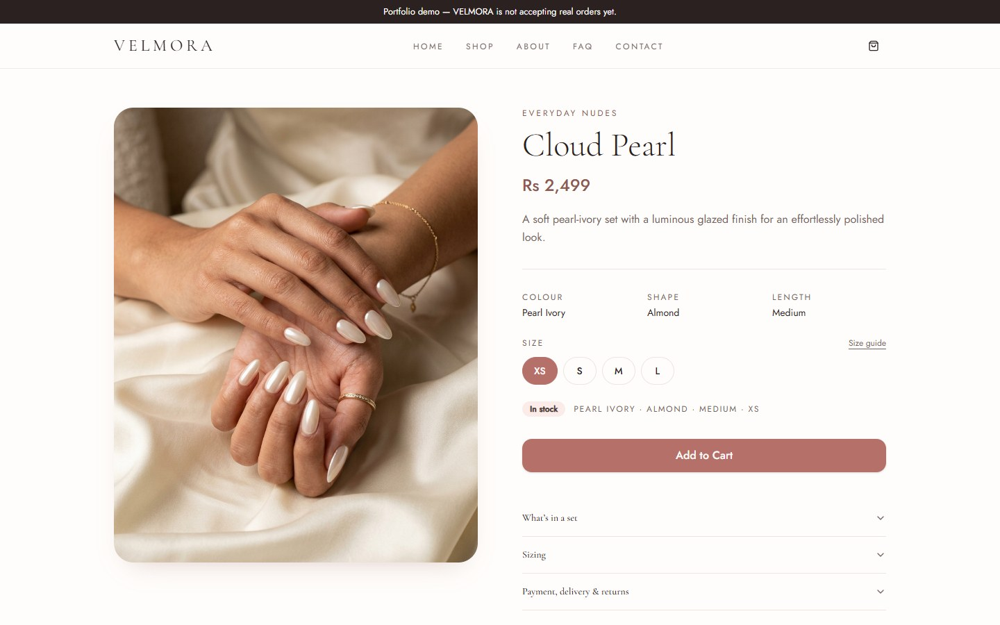
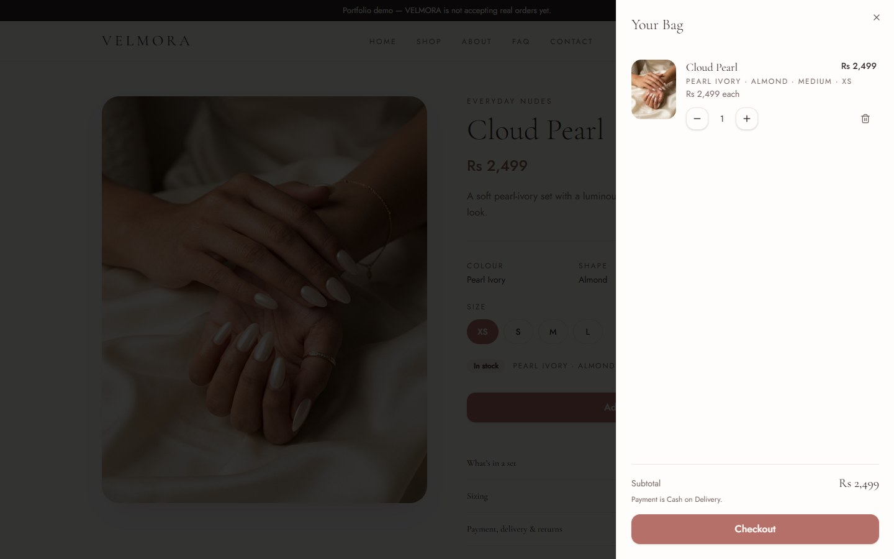
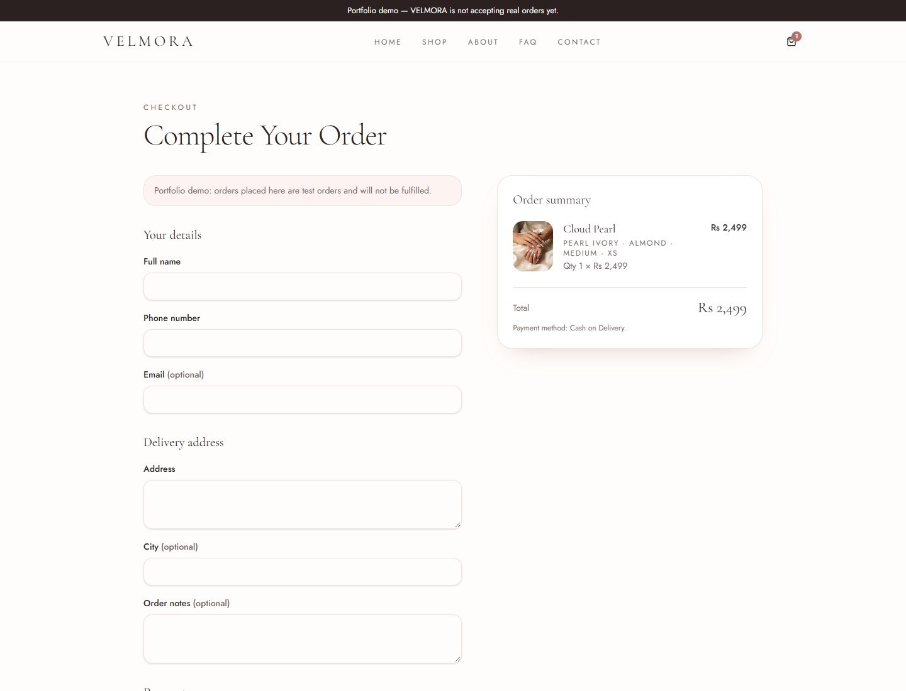
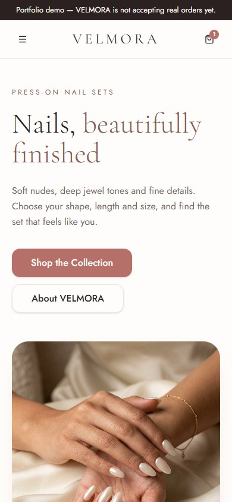
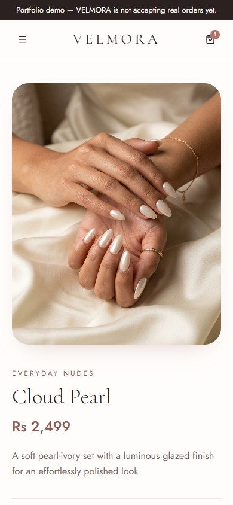

<div align="center">

# VELMORA

**Premium E-Commerce Storefront & Admin Panel**

A full-stack portfolio project: press-on nail storefront, Cash on Delivery checkout and a Supabase-authenticated admin dashboard.

[**Live demo →**](https://velmora-red.vercel.app)


</div>

> **Portfolio demonstration only.** VELMORA is not a real business and does not accept or fulfil real orders. `DEMO_MODE` is active. See the [Demo disclaimer](#demo-disclaimer).

## Contents

[Overview](#overview) · [Screenshots](#screenshots) · [Features](#features) · [Tech stack](#tech-stack) · [Architecture](#architecture) · [Database & Supabase](#database--supabase) · [Authentication & security](#authentication--security) · [Contributions](#my-contributions) · [AI-assisted development](#ai-assisted-development-disclosure) · [Setup](#installation--setup) · [Environment variables](#environment-variables) · [Commands](#local-development-commands) · [Deployment](#deployment) · [Future improvements](#future-improvements)

## Overview

VELMORA demonstrates a complete e-commerce flow for a press-on nail brand: browsing a catalogue with variants (colour, shape, length, size), a persistent cart, a validated Cash on Delivery checkout that creates orders on the server with stock checks, and an admin area for managing orders, products and inventory.

It is a working application, but deliberately presented as a demo: no payments are taken, contact and delivery details are not published, and the site says so.

## Screenshots

Captured from the [live deployment](https://velmora-red.vercel.app). The cart and checkout shots were taken by adding a product to the bag in the browser; no order was placed. The admin area and the order-confirmation screen are not shown because they require a signed-in session or a real order, and no private data is published here.

| Homepage | Product catalogue |
| --- | --- |
|  |  |

| Product details | Shopping bag |
| --- | --- |
|  |  |

| Checkout (Cash on Delivery) |
| --- |
|  |

| Mobile home | Mobile product |
| --- | --- |
|  |  |

## Features

### Storefront

- Home, About, FAQ and Contact pages, plus a product catalogue backed by Supabase
- Search and filters by shape, length, colour and price, with a result count, a "Clear filters" action and an empty state; collection links open a pre-filtered shop
- Product pages with colour, shape, length and size selection, live stock status (In stock / Low stock / Out of stock) and an inline size guide; unavailable combinations cannot be added
- Cart drawer with quantity controls, line totals and removal; the cart persists in the browser (`localStorage`) across reloads
- Cash on Delivery checkout with field-level validation, duplicate-submit protection, and clear loading, success and error states
- Orders are created on the server, which re-checks stock before creating the order and decrements it afterwards
- Responsive layout (checked at 375, 390, 768, 1024 and 1440 px), visible keyboard focus and labelled form fields
- Demo banner, footer note and checkout notice while `DEMO_MODE` is on

### Admin Panel

- Sign-in with Supabase Auth; `/admin/*` routes redirect to the login page when signed out
- Every admin data call is authorised on the server, so the client-side redirect is a convenience, not the security boundary
- Dashboard with order counts, pending orders, revenue and low-stock variants
- Orders: search by name or phone, filter by status, view order details, update status (pending, confirmed, processing, shipped, delivered, cancelled) behind a confirmation dialog
- Products: edit name, description, category, price, and the active and featured flags
- Inventory: update stock per variant with low-stock indicators

## Tech stack

- **React 19** and **TypeScript**
- **TanStack Start / Router** (file-based routing, SSR, server functions) and **TanStack Query**
- **Vite 8** and **Nitro**, built for **Vercel**
- **Supabase**: Postgres with row-level security, Auth, and Storage
- **Tailwind CSS v4** and **shadcn/ui** (Radix primitives); **Zod** for input validation

## Architecture

```text
Browser (React, TanStack Router/Query)
  ├─ public reads ──────────► Supabase (publishable key, RLS-limited to active products)
  └─ server function calls ─► TanStack Start server functions (Nitro on Vercel)
                                ├─ createOrder        (public: validates input + stock)
                                └─ admin.functions.ts (requires a Supabase session)
                                      └─► Supabase via service-role client (server only)
```

- `src/routes/`: file-based routes for the storefront (`index`, `shop`, `product.$slug`, `checkout`, `about`, `faq`, `contact`) and the admin area (`admin.*`)
- `src/lib/products.ts`: the single place product data is fetched (TanStack Query options)
- `src/lib/orders.functions.ts` and `src/lib/admin.functions.ts`: server functions, validated with Zod
- `src/integrations/supabase/`: browser client, server-only service-role client, and the auth middleware
- `src/lib/cart.tsx`: cart context persisted to `localStorage`
- The service-role client is imported dynamically inside server-function handlers, so the key never reaches the client bundle (the production bundle was scanned for it)

## Database & Supabase

Schema is defined in [`supabase/migrations/`](supabase/migrations).

| Table | Purpose | Key columns |
| --- | --- | --- |
| `products` | Catalogue entries | `name`, `slug`, `description`, `price`, `category`, `featured`, `active` |
| `product_images` | Images per product | `product_id`, `image_url`, `display_order` |
| `product_variants` | Purchasable options and stock | `product_id`, `color`, `shape`, `length`, `size`, `stock_quantity` |
| `orders` | Customer orders | customer and shipping fields, `total_price`, `order_status` |
| `order_items` | Line items | `order_id`, `variant_id`, `quantity`, `price` |

- Row-level security is enabled on all five tables
- `anon` and `authenticated` roles can only `SELECT` products, images and variants, and only rows belonging to **active** products
- `orders` and `order_items` have no public policies or grants; only the server's service-role client can read or write them
- `updated_at` triggers on products, variants and orders; indexes on slugs, status, category and foreign keys
- Product images live in a public Supabase Storage bucket named `product-images` (the bucket was created in the Supabase dashboard, not in the migrations)

## Authentication & security

- **Admin sign-in:** Supabase Auth email and password at `/admin/login`
- **Server-side checks:** each admin server function runs behind `requireSupabaseAuth`, which requires a `Bearer` token and validates it with Supabase before any data is touched
- **Secrets:** `SUPABASE_SERVICE_ROLE_KEY` is read only on the server; `.env` is git-ignored
- **Input validation:** Zod schemas on every server function that accepts input
- **Stock handling:** stock is checked before the order is created and decremented afterwards with a guard against going negative. This is not a fully serialised reservation system, so two simultaneous orders for the last item are possible in principle

**Admin access model (important):** the server currently treats *any valid Supabase session* as an administrator; there is no separate admin role or allow-list. Public sign-ups must therefore be **disabled** in the Supabase project (Authentication settings) and the admin user created manually. Adding an allow-list check is listed under [Future improvements](#future-improvements).

## My contributions

VELMORA was built with AI assistance (see below). My own role was directing and owning the project end to end:

- Defined the product, requirements and priorities, and reviewed and tested each iteration
- Set up and configured the Supabase project, including the Storage bucket, the admin account and the environment configuration
- Created the product catalogue (products, variants, prices) and supplied the product imagery
- Decided what the site may and may not claim: unverified business information was removed and the site is clearly labelled as a demo
- Set up the GitHub repository and the Vercel deployment and its environment variables, and resolved deployment and dependency issues

## AI-assisted development disclosure

This project was developed with AI tools: the initial scaffold was generated with [Lovable](https://lovable.dev), and later work (storefront polish, checkout, admin dashboard, server functions, QA and documentation) was implemented in collaboration with Claude (Anthropic). I did not hand-write every line of code. The README, and the claims in it, were checked against the repository and the live deployment.

## Installation & setup

Requires **Node.js 20.19+** (or 22.12+) and a Supabase project.

1. Clone the repository

   ```bash
   git clone https://github.com/taqdeesshahzad-01/velmora.git
   cd velmora
   ```

2. Install dependencies

   ```bash
   npm install
   ```

3. Create a `.env` file (see [Environment variables](#environment-variables)) and apply the SQL files in `supabase/migrations/` to your Supabase project. Create a public Storage bucket named `product-images` and add your own products, variants and images.
4. Create an admin user in Supabase Auth manually, and disable public sign-ups.

## Environment variables

Create `.env` in the project root (it is git-ignored). **Never commit real values.**

| Variable | Used by | Notes |
| --- | --- | --- |
| `VITE_SUPABASE_URL` | Browser | Supabase project URL |
| `VITE_SUPABASE_PUBLISHABLE_KEY` | Browser | Public (publishable) key |
| `SUPABASE_URL` | Server | Supabase project URL |
| `SUPABASE_PUBLISHABLE_KEY` | Server | Public (publishable) key |
| `SUPABASE_SERVICE_ROLE_KEY` | Server only | Secret. Never prefix with `VITE_`; never expose |

## Local development commands

```bash
npm run dev       # start the dev server and open the URL it prints
npm run build     # production build (writes .vercel/output)
npm run lint      # ESLint
npm run format    # Prettier
```

There is no automated test suite yet.

## Deployment

Deployed on **Vercel** at <https://velmora-red.vercel.app>. `vite.config.ts` sets the Nitro preset to `vercel`. Set the five environment variables above in the Vercel project, and add the deployed URL to Supabase's allowed redirect URLs. More detail, plus a manual QA checklist for the signed-in admin flows and a test order, is in [`DEPLOYMENT_AND_QA.md`](DEPLOYMENT_AND_QA.md).

## Future improvements

- Admin allow-list or role check on the server instead of "any authenticated user"
- Atomic stock reservation (a database function or transaction) to remove the last-item race
- Automated tests (unit tests for the order schema, end-to-end tests for checkout)
- Real contact, delivery and returns information, and a payment option, if it ever becomes a real shop
- Order confirmation email and order tracking
- Admin product creation and image upload (products are currently created in Supabase)
- Product sorting and pagination as the catalogue grows

## Demo disclaimer

VELMORA is a **developer portfolio project, not a real business**. `DEMO_MODE` is **active** (`src/lib/utils.ts`), so the site shows demo notices, and any order placed is a test order that will not be fulfilled. Product names, prices and stock are sample data. Contact details, delivery terms and returns policies have intentionally not been published.
